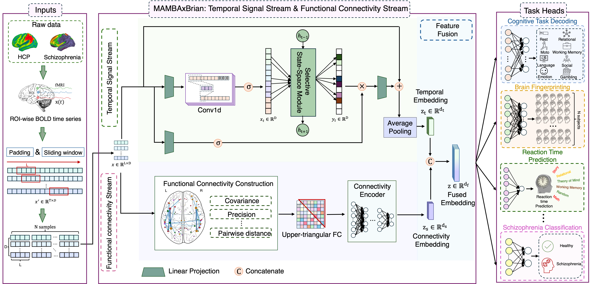

# Introduction to MAMBAxBrain

[](https://www.python.org/)
[](https://pytorch.org/)

PyTorch implementation of **MAMBAxBrain: A Multi-task Neural Framework Linking Brain Functional Dynamics to Individual Fingerprints, Cognitive and Disease States**.

> **Overview:** MAMBAxBrain combines Mamba-based temporal modeling with functional connectivity (FC) representations to learn from multiregional fMRI time series. The framework supports brain fingerprinting, cognitive task decoding, reaction-time prediction, and schizophrenia classification. The study reports strong single-task performance, cross-session generalization, and few-shot transfer across HCP tasks. Connectivity attribution analyses suggest that different objectives emphasize distinct neural circuits while retaining shared representational structure.

---

## Table of Contents

- [Introduction](#introduction)
- [Key Features](#key-features)
- [Repository Structure](#repository-structure)
- [Getting Started](#getting-started)
  - [Requirements](#requirements)
  - [Installation](#installation)
  - [Dataset Preparation](#dataset-preparation)
- [Usage](#usage)
  - [Training](#training)
  - [Training Configurations](#training-configurations)
  - [Evaluation](#evaluation)
  - [Visualization](#visualization)
- [Results](#results)
- [Citation](#citation)
- [Contact](#contact)

---

## Introduction

MAMBAxBrain integrates two complementary representations of brain activity. A temporal stream uses the Mamba selective state-space model to capture within-region dynamics, while an FC stream encodes pairwise relationships between brain regions. Their embeddings are concatenated and processed by a learnable fusion module before task-specific prediction heads.



The HCP experiments use 114 ROIs and support joint training on fingerprinting, cognitive task decoding, and reaction-time prediction. Schizophrenia classification uses a separate model instance with an 86-ROI clinical parcellation.

## Key Features

- **Dual-stream modeling:** Combines temporal dynamics with explicit functional connectivity.
- **Multiple objectives:** Supports individual identification, eight-class cognitive-state decoding, condition-level reaction-time regression, and binary schizophrenia classification.
- **Multi-task learning:** Trains shared HCP representations with classification and regression objectives.
- **Cross-session evaluation:** Evaluates HCP classification heads on separate scanning sessions.
- **Few-shot adaptation:** Adapts held-out task heads using 20% of the target-task data.

## Repository Structure

```text
MambaxBrain/
├── assets/                    # Architecture assets
├── dataset/                   # Data loading, preprocessing, and local input files
├── mamba_ssm/                 # Mamba backbone and scan operations
├── model/                     # MAMBAxBrain model definitions
├── csrc/                      # CUDA selective-scan extension
├── result_model/              # Checkpoint files
├── tests/                     # Data-protocol and model regression tests
├── config.py                  # Default training configuration
├── figure.py                  # Plotting utilities
├── main.py                    # HCP single-task and multi-task training
├── main_sz.py                 # Schizophrenia classification training
├── test_model.py              # HCP checkpoint evaluation
├── test_task.py               # Held-out task adaptation
├── train_FP.sh                # Brain fingerprinting
├── train_cognitive.sh         # Cognitive task decoding
├── train_RT.sh                # Reaction-time prediction
├── train_3tasks.sh             # Joint HCP training
├── train_sz.sh                # Schizophrenia classification
├── test_3tasks.sh              # Joint HCP checkpoint evaluation
├── setup.py                   # CUDA extension build configuration
└── requirements.txt           # Development environment snapshot
```

---

## Getting Started

### Requirements

- A Linux environment with an NVIDIA GPU and a CUDA toolkit compatible with the installed PyTorch build.
- Python and CUDA-enabled PyTorch. The supplied environment snapshot specifies PyTorch `2.0.0+cu118` and CUDA 11.8.
- NumPy, pandas, SciPy, scikit-learn, matplotlib, seaborn, einops, h5py, transformers, and the dependencies needed by the bundled Mamba modules.
- A C++/CUDA compiler and build tools for `selective_scan_cuda`.

### Installation

Clone the repository and activate your Python environment:

```bash
git clone https://github.com/YQ-XiaMLTech/MambaxBrain.git
cd MambaxBrain
```

The `requirements.txt` file records the development environment and includes machine-specific package locations. Replace those locations with package sources appropriate for your platform before installing:

```bash
python -m pip install -r requirements.txt
python setup.py build_ext --inplace
```

Use the bundled `mamba_ssm/` source together with the compiled selective-scan extension.

### Dataset Preparation

The study uses the following datasets. Data are obtained separately and are not distributed with the repository.

| Dataset | Participants | ROIs | Role in the study |
|---|---|---:|---|
| HCP Young Adult, S1200 | 770 after quality control | 114 | Fingerprinting, cognitive task decoding, and reaction-time prediction |
| HCP Test–Retest | 45 returning HCP participants, approximately 4–6 months later | 114 | Cross-session task-fMRI evaluation |
| UCSF schizophrenia cohort | 93 healthy controls and 45 patients | 86 | Schizophrenia classification |
| COBRE | 74 healthy controls and 72 patients | 86 | Independent external schizophrenia evaluation |

HCP data contain resting-state fMRI and seven task paradigms: working memory, language, motor, social, relational, gambling, and emotion. The study uses micapipe preprocessing with 100 Schaefer cortical parcels and 14 subcortical regions. Clinical data use 68 cortical and 18 subcortical regions; the UCSF pipeline includes fMRIPrep, ICA-AROMA, and global signal regression. COBRE regional time series are extracted from the NIAK-preprocessed release using the same clinical parcellation.

HCP data are available through the [Human Connectome Project](https://www.humanconnectome.org/study/hcp-young-adult), subject to registration and data-use terms. The preprocessed COBRE release is publicly available through figshare (Bellec, 2015). UCSF data are available from the corresponding authors upon reasonable request, subject to participant privacy restrictions.

#### 1. ROI time-series files

Prepare the following local directory structure:

```text
dataset/
├── processed_timeseries_114x1/
│   ├── Rest/natural/
│   ├── WM/natural/
│   ├── LANGUAGE/natural/
│   ├── MOTOR/natural/
│   ├── SOCIAL/natural/
│   ├── GAMBLING/natural/
│   ├── RELATIONAL/natural/
│   └── EMOTION/natural/
├── Retest_114x1/
│   └── <task>/natural/
└── MathalonSZ_86x1/
    └── diagnosis/natural/
```

Each `.npy` file contains **one time point**: a vector of 114 ROI values for HCP or 86 values for the clinical dataset. Files are named `<subject>_t<time_index>.npy`, for example `subj000_t000.npy`, and are concatenated in numerical time order. The HCP `subj` prefix is followed by the numeric index used in the mapping CSV.

For resting-state HCP data, the loader uses the first 2,400 time points for the primary within-session split and the remaining time points for cross-session evaluation. This assumes that the first 2,400 points correspond to the first two runs and the remainder to the last two runs. Preserve acquisition order and scan boundaries when exporting the time series.

Task-fMRI cross-session data are stored under `Retest_114x1/`. Subject identifiers must map to the same identity labels as the HCP training data. Cross-session evaluation measures session transfer for returning participants.

#### 2. Subject mappings and reaction-time masks

Place these files under `dataset/`:

| File | Required information |
|---|---|
| `subid_mapping.csv` | `sub_idx`, `Label`, `sub_id`, and reaction-time columns |
| `Schizophrenia_mapping.csv` | `subID`, `diagnosis`, and `converter` |
| `story_mask.csv` | Language Story condition |
| `math_mask.csv` | Language Math condition |
| `TOM_mask.csv` | Social Theory of Mind condition |
| `RC_mask.csv` | Social Random condition |
| `twoback_mask.csv` | Working Memory 2-back condition |

For HCP, `Label` contains identity labels from `0` to `769`; use `-1` to exclude a participant. `sub_id` matches the filename prefix in the retest dataset. Reaction-time columns are `STORY_RT`, `MATH_RT`, `Relational_RT`, `TOM_RT`, `Random_RT`, and `TwoBackRT`.

Each mask is a nonempty binary vector with the same length as the corresponding input time series. The Relational condition uses its full sequence. Targets are condition-level mean reaction times, rather than trial-by-trial response times.

For the clinical dataset, `subID` matches the filename prefix. The primary binary task uses `Healthy` and `SZ`; `HighRisk` records are excluded. Records with `converter == 1` are also excluded by the loader.

#### 3. Sampling and normalization

Classification time series are split before sliding-window extraction. For fingerprinting and cognitive decoding, the study uses within-subject temporal segments of each scan. Reaction-time data are split at the **subject × condition sample** level. Keep all windows within their assigned temporal segment.

By default, each sample is z-score normalized per ROI along time. Reaction-time sequences are zero-padded to 464 points. The temporal and FC streams use the same prepared sample.

---

## Usage

### Training

Run the script for the required objective:

```bash
# Brain fingerprinting
bash train_FP.sh

# Cognitive task decoding
bash train_cognitive.sh

# Reaction-time prediction
bash train_RT.sh

# Joint training on the three HCP objectives
bash train_3tasks.sh

# Schizophrenia classification
bash train_sz.sh
```

Scripts accept additional command-line arguments, for example:

```bash
bash train_FP.sh --dataset /path/to/processed_timeseries_114x1
SEED=526 bash train_3tasks.sh
```

For few-shot adaptation to held-out HCP objectives, use `--adapt-held-out`. The target-task training fraction defaults to 20%:

```bash
bash train_FP.sh --adapt-held-out --fewshot_train_ratio 0.2
```

### Training Configurations

The following settings correspond to Table 1 of the manuscript:

| Configuration | Fingerprinting | Cognitive decoding | Reaction time | Schizophrenia | Joint HCP training |
|---|---:|---:|---:|---:|---:|
| Sequence length | 100 | 100 | 464 | 70 | Task-dependent |
| Total samples | 3,431k | 3,431k | 4,347 | 5,796 | 3,435k |
| Train/test split | 7:3 | 7:3 | 7:3 | 6:4 | 7:3 |
| State dimension | 16 | 16 | 150 | 2 | 150 |
| Convolution kernel | 4 | 4 | 16 | 2 | 16 |
| Expansion ratio | 3 | 3 | 16 | 1 | 16 |
| Optimizer | AdamW | AdamW | AdamW | AdamW | AdamW |
| Learning rate | 8e-4 | 8e-4 | 1e-4 | 8e-4 | 5e-4 |
| Batch size | 128 | 128 | 128 | 128 | 128 |
| Maximum epochs | 60 | 60 | 60 | 60 | 60 |

Sample counts refer to the study's cohort and windowing protocol. In the CLI, `sequence_length` is the temporal window length, while `window_size` is the **stride**, set to 1 for the primary classification experiments. The RT dataset uses its own fixed padded length of 464.

Classification uses cross-entropy loss; reaction-time regression uses mean absolute error. Joint training alternates two classification batches with one regression batch. The manuscript reports mean ± standard deviation over three runs with different random seeds.

### Evaluation

Evaluate an HCP checkpoint produced by training:

```bash
RUN_DIR="saves/YOUR_RUN/train_task"

# In-domain evaluation
python test_model.py --run_dir "$RUN_DIR"

# Cross-session fingerprinting and cognitive decoding
python test_model.py --run_dir "$RUN_DIR" \
  --evaluation cross-session \
  --retest_dataset dataset/Retest_114x1
```

For a joint three-task checkpoint, the wrapper script is also available:

```bash
bash test_3tasks.sh --run_dir "$RUN_DIR"
```

Use checkpoints that match the model architecture and preprocessing configuration. The evaluation script reads the saved configuration and checks model parameters strictly. HCP evaluation writes `metrics.json` and `predictions.npz`; accuracy and R² are stored in their original numerical scale. Reaction-time evaluation also reports R² separately for each condition.

Schizophrenia training evaluates its selected checkpoint and writes window-level accuracy, AUC, and predictions to the corresponding `saves/SZ-...` directory. The subject-disjoint and external-cohort results below are separate study protocols.

### Visualization

HCP training saves task-dependent plots in its run directory, including loss curves, fingerprinting accuracy by task, cognitive-decoding confusion matrices and t-SNE embeddings, and reaction-time scatterplots. Plotting helpers are provided in `figure.py`.

---

## Results

### Single-Task Performance and Cross-Session Generalization

The following results are reported in **Table 2 of the manuscript**. Classification metrics are accuracy in percent; reaction-time prediction is R² × 100. Values are **mean ± standard deviation over three runs**.

| Model | UCSF: SZ | HCP-YA: FP | HCP-YA: TD | HCP-YA: RT (R² × 100) | Cross-session: FP | Cross-session: TD |
|---|---:|---:|---:|---:|---:|---:|
| SPDNet | 79.63 ± 0.69 | 70.91 ± 0.02 | 95.25 ± 0.08 | 82.24 ± 0.96 | 69.74 ± 0.23 | 93.37 ± 0.41 |
| BrainNetTF | 84.79 ± 0.53 | 74.55 ± 3.04 | 98.75 ± 0.07 | 88.29 ± 1.04 | 73.37 ± 2.61 | 96.81 ± 0.05 |
| CorrNN | 86.78 ± 0.99 | 93.80 ± 0.13 | 98.99 ± 0.09 | 88.09 ± 0.65 | 86.12 ± 1.78 | 97.05 ± 0.91 |
| Mamba | 82.36 ± 0.63 | 94.95 ± 0.50 | 99.43 ± 0.12 | 88.10 ± 0.71 | 83.26 ± 0.82 | 97.41 ± 0.34 |
| FST-Mamba | 85.46 ± 0.91 | 94.34 ± 0.14 | 98.82 ± 0.40 | 89.01 ± 0.04 | 87.19 ± 0.62 | 96.12 ± 0.09 |
| **MAMBAxBrain** | **91.05 ± 0.71** | **96.07 ± 0.55** | **99.47 ± 0.06** | **91.80 ± 0.40** | **94.94 ± 0.49** | **98.93 ± 0.38** |

Relative to the strongest baseline in each setting, MAMBAxBrain improves:

- Cross-session fingerprinting by **7.75 percentage points** over FST-Mamba.
- Cross-session cognitive decoding by **1.52 percentage points** over Mamba.
- UCSF schizophrenia classification by **4.27 percentage points** over CorrNN.
- Reaction-time R² × 100 by **2.79 points** over FST-Mamba.

For resting-state cross-session evaluation, the study uses the last two HCP-YA rest runs. Task-fMRI cross-session evaluation uses HCP Test–Retest.

### Additional Validation and Interpretation

Under diagnosis-stratified, subject-disjoint five-fold cross-validation, the manuscript reports schizophrenia accuracy of **82.14% ± 11.03%** and AUC of **0.83 ± 0.17**. On the independent COBRE cohort, it reports accuracy of **0.68**, AUC of **0.81**, and sensitivity of **0.43**. These results support preliminary clinical generalization while highlighting cohort-size and site-transfer limitations.

The overall reaction-time R² of approximately **0.92** primarily reflects differences between conditions; mean within-condition R² is approximately **0.19**. The distinction matters when interpreting individual behavioral prediction.

The study's connectivity attribution analyses associate individual identity with higher-order association networks, cognitive states with sensory-motor and attention systems, reaction time with subcortical-motor-limbic circuitry, and schizophrenia with altered control-sensory connectivity.

---

## Citation

If you use MAMBAxBrain in your research, please cite the accompanying manuscript:

```bibtex
@misc{xia_mambaxbrain,
  title  = {{MAMBAxBrain}: A Multi-task Neural Framework Linking Brain Functional Dynamics to Individual Fingerprints, Cognitive and Disease States},
  author = {Xia, Yuqing and Arab, Fahimeh and Saha, Urmi and Sipes, Benjamin and Gooden, Grayson and Chen, Minghan and Raj, Ashish}
}
```

## Contact

For questions, open an issue in this repository or contact [Yuqing Xia](mailto:xiayuqing0526@gmail.com).
